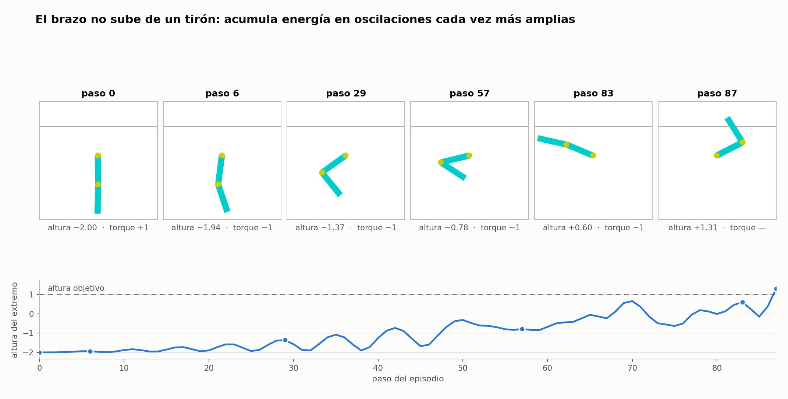
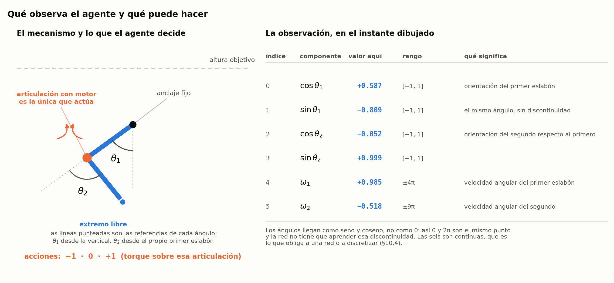
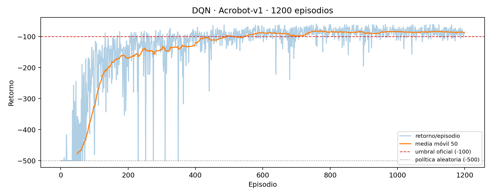

# DQN sobre Acrobot-v1

**Simulación y Aprendizaje por Refuerzo · Unidad 3 · Taller 2**
Maestría en Inteligencia Artificial, Universidad de La Sabana · MIA 2026-5
Profesor: Emilio Muñoz Pérez

**Grupo 1**

| Integrante | Correo |
|---|---|
| Saud Mauricio Gonzalez Rodriguez | saudgoro@unisabana.edu.co |
| Luis Alfonso Fajardo Andrade | luisfaan@unisabana.edu.co |
| Gloria Yaned Leguizamon Arboleda | glorialear@unisabana.edu.co |
| Ricardo Sandoval Chaves | ricardosach@unisabana.edu.co |
| Edwin Aviles Cogollo | edwinavco@unisabana.edu.co |
| Edgar Julian Mendez Ortegon | edgarmenor@unisabana.edu.co |
| Orly Alberto Alvao Barajas | orlyalba@unisabana.edu.co |

---

## 1. El ambiente

Acrobot es un péndulo doble subactuado. Dos eslabones unidos en cadena cuelgan de un punto fijo; el
motor está en la articulación **del medio**, no en la de arriba. El objetivo es levantar el extremo
libre hasta una altura determinada — concretamente, hasta que la punta del segundo eslabón supere
la altura del punto de anclaje en una unidad de longitud.

Lo que hace interesante al problema es que **el motor es demasiado débil para levantar el brazo de
un tirón**. No existe una secuencia de empujones en una sola dirección que resuelva el episodio. El
agente tiene que aprender a balancear: empujar en un sentido, dejar que la gravedad devuelva el
brazo, empujar en el otro en el momento justo, y acumular energía a lo largo de varias oscilaciones
hasta que el impulso baste. Es un problema de sincronía, no de fuerza.



Los seis fotogramas son de un episodio real de nuestro agente, renderizado por Gymnasium. El brazo
parte colgando en reposo, gana amplitud oscilación tras oscilación y cruza la altura objetivo en el
paso 87. La traza de abajo mide esa misma altura a lo largo del episodio: sube a saltos y con
retrocesos, porque cada empujón solo sirve si llega cuando el brazo ya viene en esa dirección.

En cada paso el agente elige una de tres cosas: empujar en un sentido, empujar en el otro, o no
empujar —eso es lo que rotula cada fotograma como «torque +1», «torque −1» o «torque —», y §2 lo
define con precisión—. De los 87 pasos de este episodio el agente eligió empujar en los 87, 46 veces
en un sentido y 41 en el otro, y ni una sola vez se quedó quieto; el rótulo del último fotograma no
es una excepción a eso, sino el estado ya terminal, en el que no queda decisión que tomar.

El entorno viene de Sutton (1996) y está en `gymnasium.envs.classic_control`.

## 2. El estado y las acciones

Antes de elegir un método hay cuatro cosas que entender, y en este orden: **qué observa el agente**,
**qué puede hacer**, **qué recompensa recibe** y **cuándo se acaba un episodio**. Los dos primeros
están en esta sección y los dos siguientes en §3. No es una formalidad: el estado decide la entrada
de la red, las acciones deciden su salida, la recompensa es lo único que define qué significa
«bien», y la distinción entre terminar y ser interrumpido cambia la ecuación que se optimiza —una
confusión que aparece con frecuencia en implementaciones de entornos con límite temporal.

Ninguno de los cuatro los tomamos de la documentación: los cuatro se consultan en vivo con `acrobot
inspect` sobre el entorno instalado, y esta sección reporta lo que devuelve.

**El estado primero**, porque es la entrada de la red y tiene que ser números. Estas son las seis
componentes que entrega el entorno y las tres acciones que el agente puede tomar, con los valores
reales de un instante concreto de la corrida:



**Espacio de observación:** `Box(6,)` de tipo `float32`. Las seis componentes, en orden:

| Índice | Magnitud | Rango declarado | Con política aleatoria | Con la política entrenada |
|---|---|---|---|---|
| 0 | cos θ₁ | [−1, 1] | [−0,719, +1,000] | [−1,000, +1,000] |
| 1 | sen θ₁ | [−1, 1] | [−1,000, +1,000] | [−1,000, +1,000] |
| 2 | cos θ₂ | [−1, 1] | [−1,000, +1,000] | [−1,000, +1,000] |
| 3 | sen θ₂ | [−1, 1] | [−1,000, +1,000] | [−1,000, +1,000] |
| 4 | ω₁ (velocidad angular del primer eslabón) | [−4π, 4π] ≈ ±12,566 | [−5,017, +4,914] | [−6,105, +6,684] |
| 5 | ω₂ (velocidad angular del segundo) | [−9π, 9π] ≈ ±28,274 | [−8,229, +8,191] | [−12,298, +11,621] |

Las dos columnas medidas salen de `acrobot rangos`, el comando que acompaña al código (§«Reproducción»),
que las recalcula: la aleatoria sobre 30 episodios con semillas 1000–1029, la entrenada sobre los
100 episodios de evaluación.

De la tabla se siguen dos consecuencias prácticas.

**Los ángulos vienen ya descompuestos en seno y coseno.** El entorno no entrega θ directamente, y
eso no es un capricho: θ es una variable circular, donde 0 y 2π son el mismo estado físico pero
números lejanísimos. Una red que recibiera θ tendría que aprender esa discontinuidad. Al recibir
(cos θ, sen θ) el estado se vuelve continuo y la red se ahorra el problema.

**No hizo falta preprocesar ni normalizar nada.** Cuatro de las seis componentes ya viven en
[−1, 1] por construcción. Las dos velocidades angulares declaran rangos de ±12,6 y ±28,3, y la
distribución que la red ve depende de qué política la genere: con política aleatoria el brazo casi
no se balancea y las velocidades se quedan en ±5,0 y ±8,2, mientras que con la política entrenada
—que balancea a propósito para ganar altura— llegan a ±6,7 y ±12,3. Incluso ese segundo rango, que
es el que importa, se queda holgadamente dentro de lo declarado y en una escala razonable para una
red con ReLU e inicialización estándar. Las alimentamos tal cual.

Medimos las dos distribuciones a propósito. Lo cómodo era decidir con los números de la política
aleatoria, que se obtienen antes de entrenar, y esos números subestiman en torno a un tercio lo que la red
termina recibiendo.

**Espacio de acción:** `Discrete(3)` — aplicar torque −1, 0 o +1 a la articulación central. Que sea
discreto es lo que hace el entorno compatible con DQN: el algoritmo necesita un `argmax` sobre un
conjunto finito de acciones.

## 3. La recompensa y la terminación

**Recompensa: −1 por cada paso mientras el brazo no alcance la altura objetivo; el paso que la
alcanza da 0.** (`reward = -1.0 if not terminated else 0.0`). No hay bonificación ni penalización
extra. La única manera de ganar recompensa es tardar menos pasos.

Esto hace la métrica directamente interpretable: un retorno de −80,96 significa que el agente levanta
el brazo en unos 82 pasos. Maximizar la recompensa y minimizar el tiempo son el mismo objetivo.

La señal es **escasa**: mientras el agente no llegue a la meta, todos los pasos reciben la misma
recompensa de −1. No hay ninguna pista intermedia que indique si se está yendo bien.

**Terminación — dos casos distintos:**

- `terminated = True` — el extremo libre superó la altura objetivo. Final real del episodio: el
  estado siguiente no tiene valor futuro.
- `truncated = True` — se agotaron los 500 pasos. El episodio se corta por reloj, no porque el
  mundo se acabe. El estado sigue siendo válido y tiene valor futuro.

Esta distinción la tratamos explícitamente en el código:

```python
buf.push(obs, action, reward, nxt, terminated)     # truncated NO entra al buffer
target_q = r + gamma * next_q * (1 - terminated)  # solo el terminal real anula el bootstrap
```

Si se confundieran los dos casos, el agente aprendería que el estado del paso 500 no vale nada,
cuando en realidad es un estado normal. Ese error no impide aprender, pero quita fiabilidad: en
nuestras pruebas, dos de tres semillas salían iguales y la tercera fallaba en el 12 % de los estados
de evaluación sin que la curva de entrenamiento lo delatara.

---

## 4. Flujo del entrenamiento DQN

El bucle repite siempre los mismos pasos:

```
obs ──► política ε-greedy ──► env.step(a) ──► (s, a, r, s′, terminated) ──► ReplayBuffer
                                                                                    │
                               ┌────────────────────────────────────────────────────┘
                               ▼
                      muestreo aleatorio de 64 transiciones
                               │
              ┌────────────────┴────────────────┐
              ▼                                 ▼
     Q_online(s)[a]                  max_a′ Q_target(s′, a′)
              │                                 │
              │                                 ▼
              │                  target = r + γ · max Q_target · (1 − terminated)
              ▼                                 │
              └──────── Huber loss ◄────────────┘
                               │
                      backward + clip_grad_norm(10.0) + Adam(lr=1e-3)
                               │
              cada 1.000 pasos: Q_target ← Q_online
```

**Replay buffer:** guarda las últimas 100.000 transiciones. Al muestrear al azar se rompe la
correlación entre pasos consecutivos y se reutiliza cada experiencia varias veces.

**ε-greedy con decaimiento lineal (1,0 → 0,05 en 60.000 pasos):** al principio el agente
explora sin saber nada; al final ya tiene una política y el 5 % de exploración residual evita
que se quede atascado.

**Red objetivo sincronizada cada 1.000 pasos:** sin ella la red persigue un blanco que ella
misma mueve en cada actualización. La copia congelada da estabilidad.

**Huber loss:** cuadrática para errores pequeños y lineal para los grandes, de modo que un
target ocasionalmente muy desviado no produce un gradiente que rompa el entrenamiento.

---

## 5. Particularidades del entorno

**Recompensa constante.** Todas las recompensas valen −1 hasta llegar. No hay ninguna señal
intermedia que indique si se está yendo bien. La única pista llega cuando un episodio termina de
verdad antes de los 500 pasos.

**La exploración aleatoria sí encuentra la meta.** A diferencia de MountainCar, en Acrobot una
política casi aleatoria llega a la meta con cierta frecuencia: en nuestra corrida el episodio 11
ya terminó en meta. Eso llenó el buffer de ejemplos exitosos desde el arranque, y por eso bastó
ε-greedy sin ninguna técnica especial de exploración.

**Subactuación.** El brazo tiene que balancearse varias oscilaciones para acumular energía. Esto
significa que la velocidad angular es tan importante como la posición, y el vector de observación
ya la incluye, así que el estado es markoviano y no hace falta memoria adicional.

---

## 6. Arquitectura de la red neuronal

```
Entrada  6  (las seis componentes del estado)
   │
Linear(6 → 128)   + ReLU          896 parámetros
   │
Linear(128 → 128) + ReLU       16.512 parámetros
   │
Linear(128 → 3)                   387 parámetros
   │
Salida   3  (un valor Q por acción)
                        ─────────────────────
                Total    17.795 parámetros
```

**Por qué MLP y no CNN:** la observación es un vector de 6 números físicos, no una imagen. No
hay estructura espacial que explotar.

**Por qué dos capas de 128:** la función Q depende de productos entre ángulos y velocidades, que
no son lineales. Dos capas dan capacidad suficiente sin sobredimensionar la red.

**Por qué ReLU:** es la activación estándar, no satura para valores positivos y es
computacionalmente barata.

**Por qué la salida no tiene activación:** los valores Q son retornos descontados esperados, que
en este entorno oscilan entre −100 y 0. Una sigmoide o softmax no podría representar ese rango.
Además, DQN no produce probabilidades: produce valores por acción y la política toma el `argmax`.

---

## 7. Hiperparámetros

| Parámetro | Valor | Justificación |
|---|---:|---|
| Episodios | 1.200 | suficiente para estabilizar la media móvil por encima de −90 |
| γ (descuento) | 0,99 | horizonte efectivo ≈ 100 pasos, del orden del episodio resuelto |
| Learning rate | 1e-3 | estándar de Adam para redes pequeñas |
| Batch size | 64 | balance entre varianza del gradiente y coste por paso |
| Buffer | 100.000 | cubre varias etapas del entrenamiento |
| Learning starts | 1.000 | evita entrenar con un buffer casi vacío |
| Target update | 1.000 pasos | mantiene el blanco fijo mientras se recorren varias trayectorias |
| ε inicio / fin | 1,0 → 0,05 | exploración total al inicio; 5 % residual al final |
| ε decay steps | 60.000 | ≈ 38 % del entrenamiento con exploración activa |
| Capas ocultas | 128 | ver §5 |
| Clip grad norm | 10,0 | estabiliza gradientes grandes sin amortiguar los pequeños |
| Semilla | 42 | reproducibilidad |
| Episodios de evaluación | 100 | muestra suficiente para estimar el retorno medio con margen estrecho |

---

## 8. Resultados del entrenamiento

La corrida canónica usó la semilla 42 y corrió sobre CPU.

| Métrica | Valor |
|---|---:|
| Episodios entrenados | 1.200 |
| Pasos de entorno | 158.451 |
| Mejor episodio | −60 (episodio 760) |
| Media de los últimos 100 episodios | −85,68 |
| Episodios que alcanzan la meta (total) | 95,6 % |
| Episodios que alcanzan la meta (últimos 100) | **100 %** |
| Último episodio truncado | 350 |

### Evaluación final (política greedy, 100 episodios con semillas nuevas)

| Métrica | Valor |
|---|---:|
| **Retorno medio** | **−80,96** |
| IC 95 % | [−83,41, −78,51] |
| Desviación estándar | 12,52 |
| Episodios que alcanzan la meta | **100 / 100** |
| Umbral oficial del entorno | −100,0 |
| Política aleatoria (referencia) | −500,0 |

El resultado supera el umbral oficial por 19 puntos y generaliza a condiciones iniciales que el
agente nunca vio durante el entrenamiento.

### Curva de aprendizaje



La media móvil supera el umbral de −100 en el episodio 492 y se mantiene por encima desde el
episodio 548. Las bandas que bajan hasta −500 son los episodios truncados; desaparecen por completo
después del episodio 350.

---

## 9. Reflexión sobre los resultados

Lo primero que miramos fue la media del retorno, y eso nos hizo pensar que el agente dejó de
aprender a mitad del entrenamiento. Cuando miramos la desviación estándar nos dimos cuenta de que
seguía mejorando, solo que de otra manera: en la primera mitad bajó de −291 a −99, y en la segunda
no cambió tanto en media pero la desviación cayó de 70 a 14. El agente pasó de resolver Acrobot a
resolverlo de forma consistente, sin episodios catastróficos.

La curva de la loss también nos confundió al principio. Creció mientras el retorno mejoraba, de
0,006 a 0,48, y lo primero que pensamos fue que algo andaba mal. Cuando revisamos qué mide la loss
de un DQN entendimos que no: mide el desacuerdo entre la red y un objetivo que se mueve, y ese
desacuerdo crece a medida que los valores Q se separan y el problema de regresión se vuelve más
difícil. Una loss creciente con retorno creciente no es un problema.

La comparación con MountainCar, que vimos en clase, nos ayudó a entender por qué Acrobot funcionó
bien con ε-greedy simple: en MountainCar la exploración aleatoria casi nunca llega a la meta, así
que el buffer no tiene trayectorias exitosas de las que aprender. En Acrobot sí las tiene desde el
episodio 11. Eso cambia todo.

---

## 10. Reflexión sobre lo que más costó

Lo que más tiempo nos llevó entender fue la diferencia entre `terminated` y `truncated` en
Gymnasium. Los dos detienen el bucle de Python de la misma manera, pero significan cosas distintas
para la ecuación de Bellman: cuando el episodio termina de verdad no hay estado siguiente que valga
nada, pero cuando se corta por el límite de 500 pasos el estado es perfectamente válido y tiene
valor futuro.

Al principio lo tratamos igual y el entrenamiento funcionó, lo que nos llevó a pensar que daba lo
mismo. Cuando lo probamos con varias semillas vimos que no: en la mayoría funciona igual, pero en
alguna el agente aprende una política que falla en ciertos estados iniciales sin que la curva de
entrenamiento lo delate. El error no se ve durante el entrenamiento; solo aparece al evaluar sobre
condiciones que el agente nunca recorrió.

La segunda dificultad fue interpretar las métricas sin caer en lecturas automáticas. Ver la loss
subir mientras el retorno mejoraba iba en contra de la intuición del aprendizaje supervisado, y
hubo que volver a la ecuación para entender por qué era correcto. Esa disciplina —entender qué mide
cada número antes de reaccionar— nos parece lo más transferible de todo el trabajo.

---

## Reproducción

El trabajo tiene dos formas de recorrerse: el **notebook** y el **CLI**. Las dos producen los
mismos números y se pueden usar de forma independiente; ninguna modifica los resultados ya guardados.

### Opción A — el notebook (sin instalar nada)

```bash
pip install jupyterlab   # si aún no está instalado
jupyter lab notebooks/SAR_U3_Taller2_DQN_EJECUTADO.ipynb
```

El notebook **ya viene ejecutado**: todas las celdas tienen sus salidas guardadas. Se puede leer
de arriba a abajo sin elegir kernel ni correr nada, igual que un PDF interactivo. Alterna el código
con su explicación en el mismo orden en que se tomaron las decisiones, así que es la forma más
directa de seguir el razonamiento completo.

Si se quiere volver a correr alguna celda, se puede hacer sin problema — el notebook usa los mismos
pesos y datos que el CLI, así que no "daña" nada. Lo único que sobrescribiría son sus propias salidas.

### Opción B — la línea de comandos

#### Instalación

**Linux / macOS:**
```bash
git clone <url-del-repositorio> && cd rl_acrobot
python -m venv .venv && source .venv/bin/activate
pip install -e .
```

**Windows (Anaconda Prompt):**
```bat
conda activate <entorno-con-pytorch>
cd ruta\al\repositorio\rl_acrobot
pip install -e .
```

**Windows (PowerShell):**
```powershell
python -m venv .venv
.venv\Scripts\Activate.ps1
$env:PYTHONUTF8 = "1"
pip install -e .
```

#### Comandos principales

```bash
acrobot version                       # versiones instaladas y dispositivo (CPU/GPU)
acrobot inspect                       # audita el entorno en vivo: espacios, recompensa, umbral
acrobot train --mode smoke            # prueba rápida del pipeline (~20 s)
acrobot train --mode full             # entrena de cero (1.200 episodios)
acrobot train --mode full --seed 42   # la corrida canónica reportada en este README
acrobot evaluate --episodes 100       # evalúa la política guardada con semillas nuevas
acrobot plot --output curva.png       # regenera la curva de aprendizaje
acrobot results                       # muestra los resultados de las cinco semillas en consola
acrobot verify                        # comprueba que los números del README coinciden con los artefactos
acrobot rangos                        # mide los rangos de observación con política aleatoria y entrenada
acrobot ambiente                      # renderiza un episodio y genera la figura de la sección 1
acrobot estado                        # genera la figura del estado y las acciones de la sección 2
acrobot ablacion                      # entrena la variante que confunde truncación con terminación
acrobot ablacion --solo-figura        # regenera su figura sin reentrenar
acrobot double                        # entrena Double DQN y lo compara con el DQN del entregable
acrobot sesgo                         # mide el sesgo de los valores Q por distancia a la meta
acrobot minilotes                     # cuenta en cuántas actualizaciones entra el error de la ablación
acrobot tabular                       # entrena Q-learning tabular y lo compara con el DQN
acrobot demo                          # abre ventana pygame con el agente jugando en tiempo real
```

#### Ver el agente en tiempo real

```bash
acrobot demo                       # 3 episodios (por defecto)
acrobot demo --episodios 5         # cinco episodios seguidos
acrobot demo --pausa 0.05         # más lento, fácil de seguir
acrobot demo --pausa 0            # máxima velocidad
acrobot demo --seed 10042         # condición inicial distinta
```

Para salir: **Ctrl + C** en la terminal, o cierra la ventana con el botón **×**.

### Qué usar según el objetivo

| Para… | Opción |
|---|---|
| leer el razonamiento paso a paso | notebook |
| ver el código y las salidas juntos sin ejecutar nada | notebook |
| comprobar que los números del README son reales | `acrobot verify` |
| ver el agente en acción | `acrobot demo` |
| reproducir el entrenamiento desde cero | `acrobot train --mode full` |

---

## Referencias

- Mnih, V. et al. (2015). *Human-level control through deep reinforcement learning*. Nature 518.
- Lapan, M. (2020). *Deep Reinforcement Learning Hands-On* (2.ª ed.). Packt.
- Documentación de Gymnasium: https://gymnasium.farama.org/environments/classic_control/acrobot/

---

> 📄 Para los experimentos de control completos (robustez con cinco semillas, ablación de truncación, Double DQN y baseline tabular) ver [docs/ANALISIS_EXTENDIDO.md](docs/ANALISIS_EXTENDIDO.md).
